# Bài 4: Bảo mật Web App và API

Gồm 2 phần thực hành:

| Thư mục | Nội dung | Sách |
|---|---|---|
| `web-vuln-scanner/` | Công cụ quét lỗ hổng web: XSS, SQL Injection, CSRF, SSRF; có báo cáo, CLI, web UI (Flask) và unittest | 4.2 (trang 98–111) |
| `jwt-security-tools/` | Bộ công cụ bảo mật JWT: validator, cracker (brute force khoá yếu), OAuth client, token manager, API gateway; có pytest | 4.4 (trang 115–122) |
| `screenshots/` | Ảnh kết quả chạy thực tế | |

Môi trường chạy: Windows 11, Python 3.14, venv `.venv` ở thư mục gốc repo.

Toàn bộ là bài lab giáo dục: công cụ chỉ quét/kiểm thử trên site lab được phép
(`testphp.vulnweb.com`, `xss-game.appspot.com`) hoặc máy của mình, và các khoá bí
mật (`supersecret`, `mysecret`) chỉ là giá trị demo.

---

## 1. web-vuln-scanner

```
web-vuln-scanner/
├── scanners/
│   ├── __init__.py
│   ├── xss_scanner.py            # XSSScanner: gửi payload qua ?q=, kiểm tra phản hồi (requests)
│   ├── sql_injection_tester.py   # SQLInjectionTester: dò payload SQLi trong tham số URL
│   ├── csrf_detector.py          # CSRFDetector: tìm csrf_token trong HTML (regex)
│   └── ssrf_tester.py            # SSRFTester: phát hiện IP nội bộ/loopback/link-local trong tham số
├── report/
│   ├── __init__.py
│   └── report_generator.py       # ReportGenerator: gộp findings (list/dict) thành báo cáo
├── tests/                        # unittest: test_xss, test_sql_injection, test_csrf, test_ssrf, test_report
├── ui/
│   ├── app.py                    # web Flask, http://127.0.0.1:5000
│   └── templates/index.html, result.html
├── __init__.py
├── main.py                       # chạy cả 4 scanner rồi in báo cáo ra terminal
└── requirements.txt
```

### Cài đặt và chạy

```powershell
.\.venv\Scripts\Activate.ps1        # từ thư mục gốc repo; đầu dòng sẽ hiện (.venv)
cd Bai4\web-vuln-scanner
pip install -r requirements.txt

# Unit test (đứng trong web-vuln-scanner để import scanners.* được)
python -m unittest discover tests

# Chạy báo cáo trên terminal
python .\main.py

# Web UI
python .\ui\app.py                  # mở http://127.0.0.1:5000
```

### Kết quả

**Cài gói và chạy Unit Tests (9 passed):**

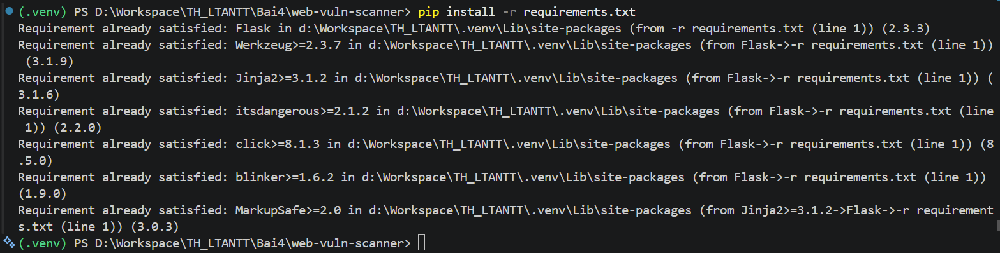
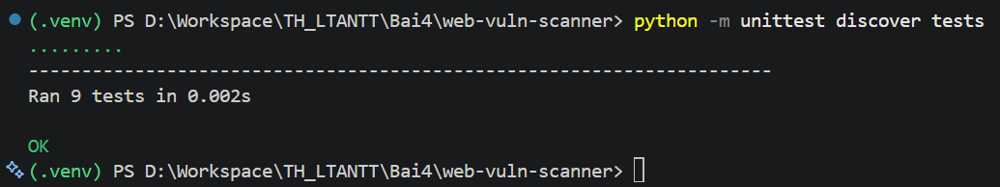

**`main.py`:** in `=== Vulnerability Report ===`. Mục đầu không có trường (do
`csrf.scan` trả về dict `{'csrf_protected': True}` khi HTML có token), mục sau là
SSRF `High` (phát hiện `127.0.0.1` trong URL) — giống output ở trang 109:

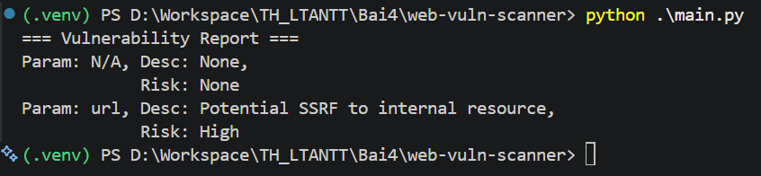

**Web UI:** chạy Flask, mở trang form chọn 4 công cụ:

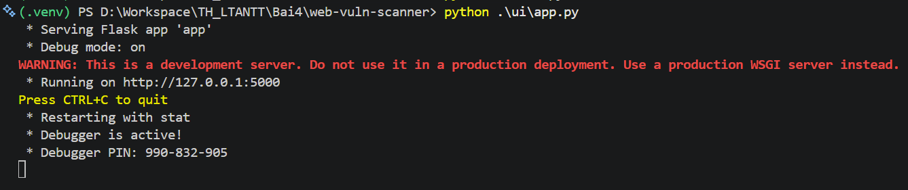
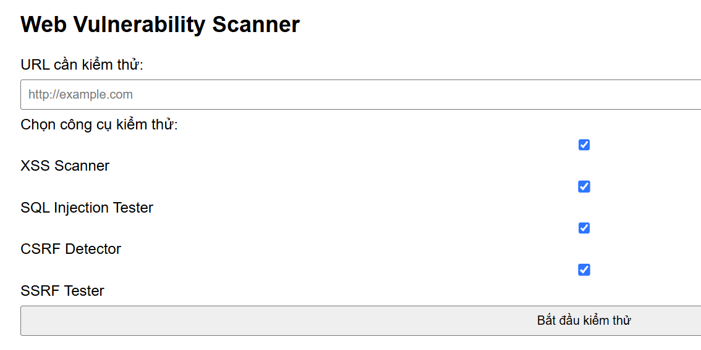

**Nhập URL test** (`testphp.vulnweb.com/artists.php?artist=1`) rồi bấm *Bắt đầu kiểm thử*.
Kết quả báo cáo lỗ hổng CSRF (Medium) — với URL này XSS/SQL/SSRF không kích hoạt nên
không hiện; CSRF luôn bị gắn cờ vì `app.py` kiểm tra một form không có token:

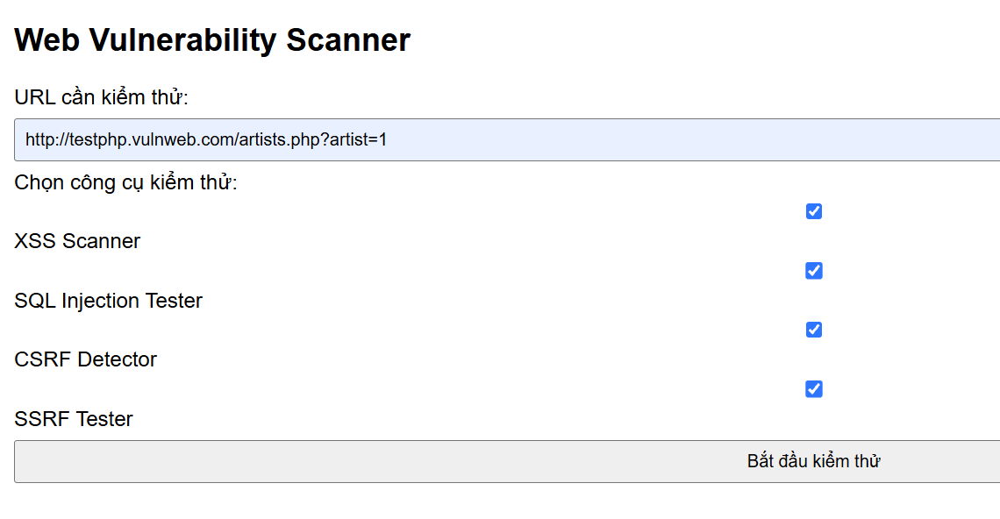
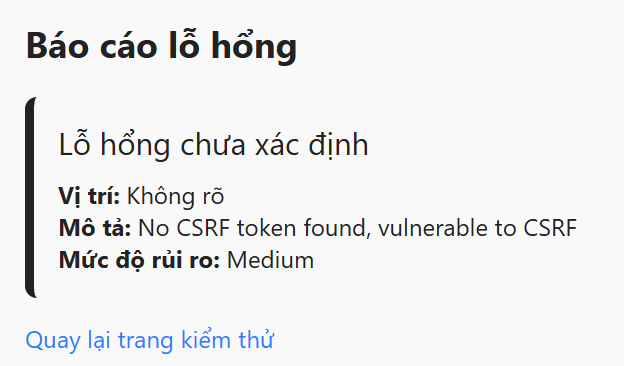

---

## 2. jwt-security-tools

```
jwt-security-tools/
├── jwt_validator/validator.py    # JWTValidator: kiểm tra token, phân biệt hết hạn / sai chữ ký
├── jwt_cracker/cracker.py        # JWTCracker: brute force khoá HS256 theo wordlist (ThreadPool)
├── oauth_client/client.py        # OAuthClient: dựng auth_url, đổi code lấy token (Authorization Code)
├── token_manager/manager.py      # TokenManager: phát hành access/refresh token, làm mới access
├── api_gateway/gateway.py        # APIGateway: route /protected xác thực JWT trong header
├── tests/                        # pytest: test_validator, test_cracker, test_oauth_client,
│                                 #         test_token_manager, test_api_gateway
├── __init__.py trong từng package trên
├── main.py                       # sinh token cho user rồi mở gateway
├── pytest.ini                    # pythonpath = .
└── requirements.txt              # PyJWT, requests, flask, pytest
```

### Cài đặt và chạy

```powershell
# (cần kích hoạt .venv như ở phần 1)
cd Bai4\jwt-security-tools
pip install -r requirements.txt

# Unit test
pytest tests/

# Sinh token + mở API gateway (cổng 5000 — tắt web UI ở phần 1 trước nếu đang chạy)
python .\main.py
```

Sau khi `main.py` in ra Access Token, mở **Command Prompt** khác và gọi endpoint
được bảo vệ (dán token vừa sinh):

```cmd
curl -H "Authorization: Bearer <ACCESS_TOKEN>" http://127.0.0.1:5000/protected
```

### Kết quả

**Cài gói và chạy pytest (7 passed):**

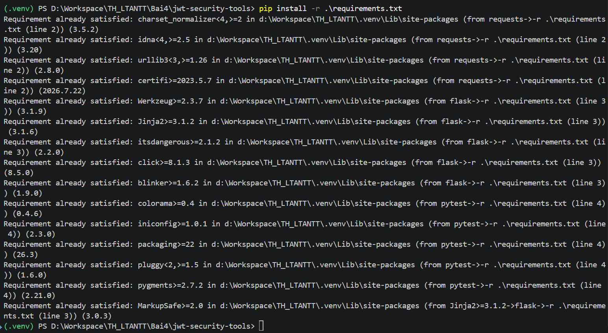
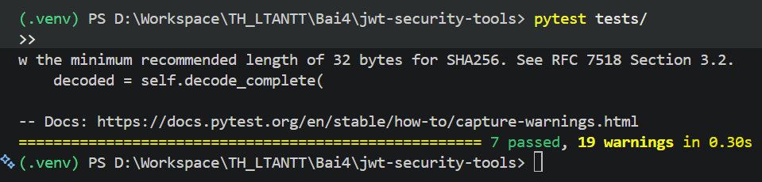

**`main.py`:** in Access Token và Refresh Token, rồi chạy gateway ở `127.0.0.1:5000`:

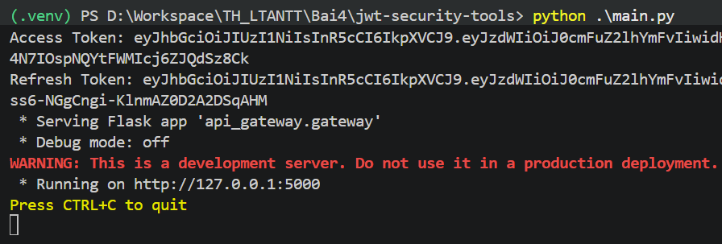

**Xác thực bằng curl:** gửi Access Token qua header `Authorization: Bearer`, gateway
giải mã hợp lệ và trả `Access granted` kèm `user` lấy từ claim `sub`:

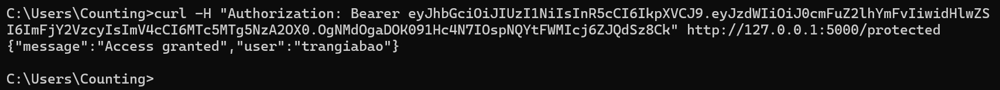

---

## Những điểm đã sửa / khác so với sách

Code gõ đúng theo sách (mục 4.2 và 4.4). Chỉ khác ở những chỗ sau:

- **`web-vuln-scanner/requirements.txt`**: thêm `requests`. Sách (trang 99) chỉ liệt
  kê `Flask`, nhưng `scanners/xss_scanner.py` có `import requests` — nếu không thêm,
  `test_xss` sẽ báo `ModuleNotFoundError: No module named 'requests'`.
- **`jwt-security-tools/main.py`**: đổi `generate_tokens("phuoc")` → `"trangiabao"`,
  nên endpoint `/protected` trả về `"user": "trangiabao"`.
- **`datetime.utcnow()`** (trong `token_manager/manager.py` và `tests/test_validator.py`)
  giữ nguyên như sách; hàm này đã deprecated ở Python mới nên khi chạy có
  `DeprecationWarning` (giống phần "7 warnings" ở trang 121). Bản PyJWT mới còn thêm
  `InsecureKeyLengthWarning` (khoá HS256 ngắn hơn 32 byte) nên tổng cộng **19 warnings**,
  nhưng số test pass vẫn đúng **7 passed**.

Một số hành vi của code gốc thấy được trong ảnh kết quả:

- `main.py` của scanner: mục đầu báo cáo là `Param: N/A, Desc: None, Risk: None` vì
  `csrf.scan` trả về **dict** `{'csrf_protected': True}` (HTML truyền vào có token) chứ
  không phải list finding — `ReportGenerator` vẫn thêm dict này vào báo cáo. Ảnh ở
  trang 109 cũng hiện y hệt.
- Trang kết quả web hiện tiêu đề "Lỗ hổng chưa xác định" vì finding CSRF không có
  trường `type`; template `result.html` dùng `default('Lỗ hổng chưa xác định')`.
