# Bài 5: Phân tích và Kiểm thử Bảo mật (SAST & DAST)

Gồm 2 phần thực hành:

| Thư mục | Nội dung | Sách |
|---|---|---|
| `sast-tool/` | Công cụ phân tích bảo mật **tĩnh** (SAST) cho mã Python: duyệt AST, dò pattern, bộ luật, kiểm tra chất lượng (flake8), xuất báo cáo SARIF; có unittest | 5.2 |
| `dast-tool/` | Nền tảng phân tích **động** (DAST): giám sát runtime, bộ nhớ, mạng, hành vi và sandbox; có CLI, web API (Flask) và unittest | 5.4 |
| `screenshots/` | Ảnh kết quả chạy thực tế | |

Môi trường chạy: Windows 11, Python 3.14, venv `.venv` ở thư mục gốc repo.

Toàn bộ là bài lab giáo dục: `examples/vulnerable_*.py` là mã lỗi **cố ý** để kiểm thử
công cụ, các mật khẩu/chuỗi nhạy cảm (`admin@123`, `secret`) chỉ là giá trị demo.

---

## 1. sast-tool

```
sast-tool/
├── sast_tool/
│   ├── __init__.py
│   ├── ast_analyzer.py            # ASTAnalyzer: duyệt AST tìm lời gọi eval()
│   ├── vuln_pattern_matcher.py    # VulnPatternMatcher: regex dò hardcoded password, import pickle
│   ├── security_rule_engine.py    # SecurityRuleEngine: nạp rule JSON, gán severity cho issue
│   ├── code_quality_checker.py    # CodeQualityChecker: chạy flake8, gom cảnh báo lint
│   ├── sarif_reporter.py          # SarifReporter: xuất report.sarif theo chuẩn SARIF 2.1.0
│   └── main.py                    # gom 4 bộ phân tích rồi ghi report.sarif
├── examples/
│   ├── vulnerable_01.py           # hardcoded password + import pickle + eval
│   └── vulnerable_02.py           # eval / exec + đọc file
├── rules/default_rules.json       # Use of eval (high), Pattern Match (medium), Lint Issue (low)
├── tests/                         # unittest: test_ast_analyzer, test_vuln_pattern_matcher,
│                                  #           test_security_rule_engine, test_code_quality_checker,
│                                  #           test_sarif_reporter
└── requirements.txt              # flake8, sarif-om, jsonpickle
```

### Cài đặt và chạy

```powershell
.\.venv\Scripts\Activate.ps1        # từ thư mục gốc repo; đầu dòng sẽ hiện (.venv)
cd Bai5\sast-tool
pip install -r requirements.txt

# Unit test (đứng trong sast-tool để import sast_tool.* được)
python -m unittest discover tests

# Phân tích một file và xuất report.sarif
python -m sast_tool.main .\examples\vulnerable_01.py
python -m sast_tool.main .\examples\vulnerable_02.py
```

Cài extension **SARIF Viewer** trong VS Code rồi mở `report.sarif` để xem danh sách lỗ hổng.

### Kết quả

**Cài gói và chạy Unit Tests (6 passed):**

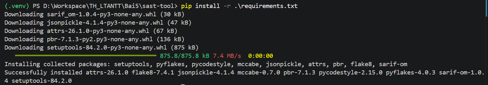
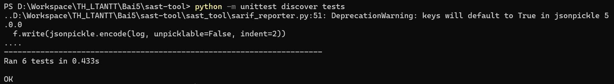

**`main.py`:** quét `vulnerable_01.py` phát hiện **4 issues** (eval, hardcoded password,
import pickle, 1 cảnh báo lint của flake8); `vulnerable_02.py` phát hiện **1 issue** (eval):

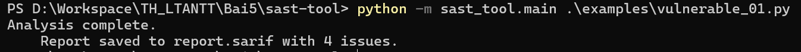
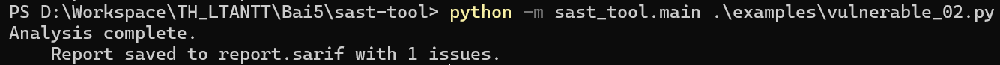

**SARIF Viewer:** mở `report.sarif`, panel *SARIF Results* liệt kê 4 cảnh báo của
`vulnerable_01.py`:

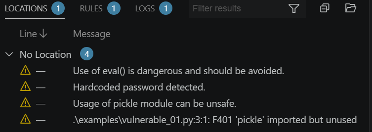

---

## 2. dast-tool

```
dast-tool/
├── runtime_monitor.py            # RuntimeMonitor: CPU / RAM / open files của tiến trình (psutil)
├── memory_analyzer.py            # MemoryAnalyzer: rò rỉ bộ nhớ (gc) + kiểm tra tràn số nguyên
├── network_traffic_analyzer.py   # NetworkTrafficAnalyzer: thống kê lưu lượng mạng theo từng NIC
├── security_behavior_checker.py  # SecurityBehaviorChecker: dò os.system / eval / exec trong mã
├── virtual_sandbox.py            # VirtualSandbox: chạy lệnh trong thư mục tạm cách ly
├── main.py                       # chạy lần lượt 5 thành phần rồi in kết quả ra terminal
├── app.py                        # Flask API: /api/monitor, /memory, /network, /security, /sandbox
├── tests/                        # unittest: test_memory_analyzer, test_network_traffic_analyzer,
│                                 #           test_runtime_monitor, test_security_behavior_checker,
│                                 #           test_virtual_sandbox
├── __init__.py
└── requirements.txt              # psutil, Flask
```

### Cài đặt và chạy

```powershell
# (cần kích hoạt .venv như ở phần 1)
cd Bai5\dast-tool
pip install -r requirements.txt

# Unit test
python -m unittest discover -s tests

# Giám sát qua CLI
python .\main.py

# Web API (cổng 5000)
python .\app.py                     # mở http://127.0.0.1:5000
```

Khi `app.py` đang chạy, mở trình duyệt vào các endpoint `GET` (`/api/monitor`,
`/api/memory`, `/api/network`, `/api/security`) hoặc gọi endpoint `POST /api/sandbox`
bằng PowerShell ở **terminal khác**:

```powershell
Invoke-RestMethod -Uri http://127.0.0.1:5000/api/sandbox -Method Post `
  -ContentType "application/json" -Body '{"command":"echo Hello Sandbox"}'
```

> Lưu ý: trong PowerShell, `curl` là alias của `Invoke-WebRequest` nên không nhận
> `-H`/`-d`. Dùng `Invoke-RestMethod` như trên, hoặc gọi `curl.exe` (curl thật).

### Kết quả

**Cài gói và chạy Unit Tests (5 passed):**

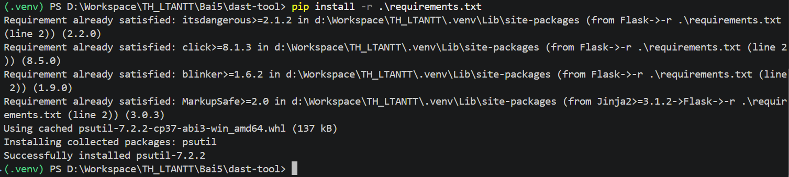
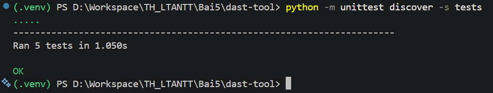

**`main.py`:** in CPU/RAM/open files, kết quả rò rỉ bộ nhớ (`[]`) và tràn số (`True`),
thống kê mạng theo NIC, `Suspicious Calls: ['os.system', 'eval', 'exec']` và output
sandbox `Hello Sandbox`:

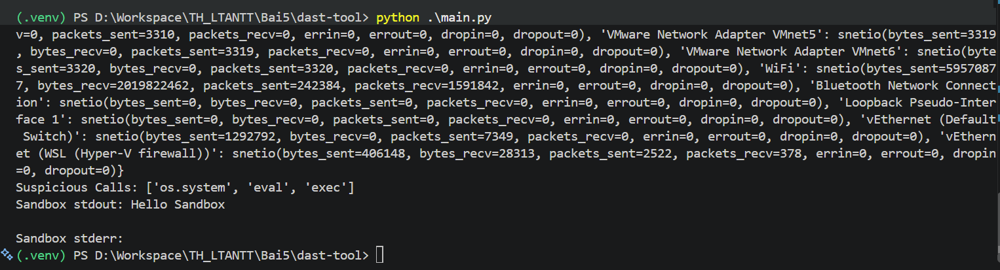

**Web API:** chạy Flask ở `127.0.0.1:5000`:

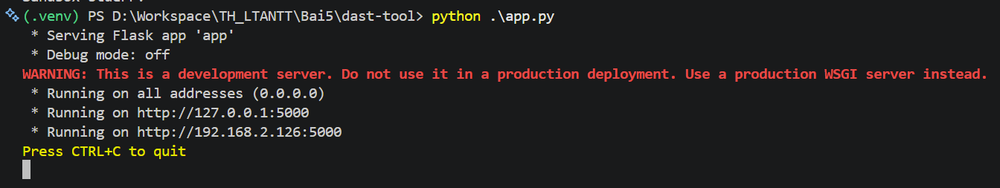

Gọi lần lượt các endpoint, mỗi endpoint trả JSON tương ứng:

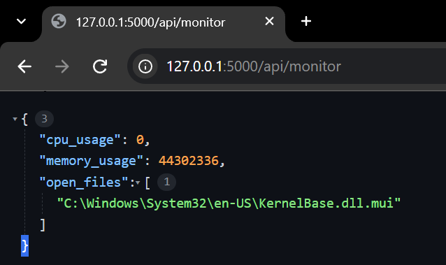
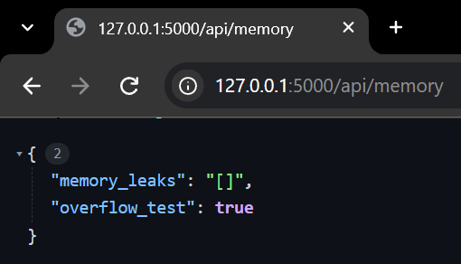
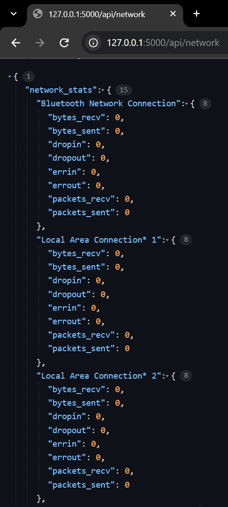
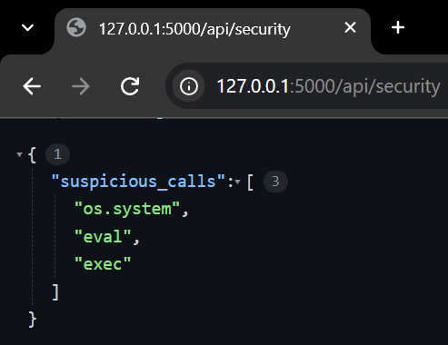

**`POST /api/sandbox`:** gửi lệnh `echo Hello Sandbox`, sandbox chạy trong thư mục tạm
và trả về stdout:

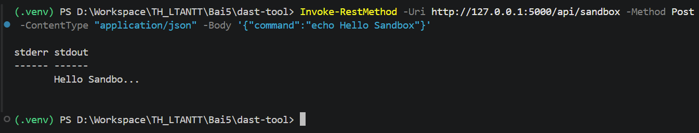

---

## Những điểm đã sửa / khác so với sách

Code bám theo mục 5.2 và 5.4, nhưng được viết lại cho khác bản in (đổi thụt lề, tách
biến trung gian, đưa pattern/syscalls/rule thành hằng số của class, thêm docstring,
đổi tên biến và viết lại comment). Các khác biệt đáng chú ý:

- **Thêm `encoding="utf-8"` ở 2 chỗ** (`sast_tool/main.py` khi đọc file cần phân tích,
  và `dast-tool/security_behavior_checker.py` khi đọc `__file__`). Windows mặc định
  dùng cp1252, nên nếu không chỉ định UTF-8 thì file có comment tiếng Việt sẽ gây
  `UnicodeDecodeError` — khiến `main.py` của SAST crash và `suspicious_calls()` của
  DAST trả về `[]` sai.
- **Bỏ các import thừa** so với sách: `import time` trong `runtime_monitor.py` và
  `import os` trong `security_behavior_checker.py` (đều không được dùng).
- **File `examples/` khác nội dung sách** nên số issue khác: `vulnerable_01.py` ra
  **4 issues** (sách 8) và `vulnerable_02.py` ra **1 issue** (sách 4). Đây là kết quả
  đúng với mã ví dụ của mình, không phải lỗi.
- Thêm khối `if __name__ == "__main__": unittest.main()` vào các file test để có thể
  chạy riêng từng file.

Một số hành vi của code thấy được trong ảnh kết quả:

- `python -m unittest discover tests` của SAST hiện `DeprecationWarning` của jsonpickle
  (`keys will default to True in jsonpickle 5.0.0`) — vô hại, vẫn **6 passed (OK)**.
- `suspicious_calls()` trả về đủ `['os.system', 'eval', 'exec']` vì hàm quét chính
  file nguồn của nó, mà 3 chuỗi này nằm trong hằng số `SUSPICIOUS_CALLS` của file.
